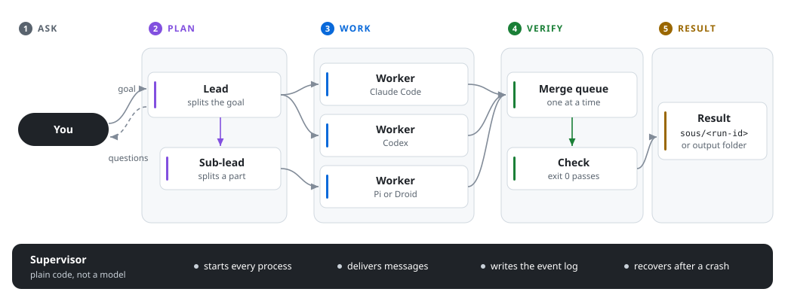

# sous

[](https://www.npmjs.com/package/@krimvp/sous)
[](package.json)
[](LICENSE)

sous runs a goal to completion on your machine with a tree of AI agents.

You give it a goal. A **lead** agent splits the goal into parts. **Workers** (Claude Code, Codex, Pi or Factory
Droid) do the parts. **Checks** test the result. Plain code, not a model, starts every process, delivers every
message, merges the work and recovers after a crash. Only merge conflicts go to an agent.

The name comes from the kitchen brigade: the sous chef splits an order across the stations, and each plate is
inspected before it leaves the kitchen.

- **Local.** One process per run. The whole state is plain files in `.sous/runs/<run-id>/`.
- **Any worker.** Each coding-agent CLI sits behind a small adapter. All four pass the same conformance suite.
- **Safe to stop.** `sous resume` continues a stopped or crashed run and does not repeat finished work.
- **Your branch stays yours.** In a git repository the result is a new branch. sous does not change your checkout.
- **Open traces.** Runs export to [ATIF](https://github.com/laude-institute/harbor) and to Langfuse over OTLP.

## Quickstart

You need Node.js 22.19 or later (Linux or macOS; the tests run on both), a logged-in
[Claude Code](https://claude.com/claude-code), and, for code, a git repository with at least one commit. Workers see
your last commit (`HEAD`) only, so commit what they need first. Codex, Pi or Droid can do the work instead of Claude
Code, but then the lead needs a model credential of its own ([Where leads run](docs/usage.md#where-leads-run)).

```bash
npm install -g @krimvp/sous
sous doctor                    # could a run start here?
sous run --max-cost 1 "Add greeting.txt containing hello, with a check that verifies it"
sous diff                      # what the run changed, on branch sous/<run-id>
git merge sous/<run-id>        # take it into your branch
sous clean                     # remove the run's worktrees; keeps sous/<run-id> and the log
```

With only Claude Code logged in and no lead credential, `sous doctor` prints, for example:

```
claude: 2.1.325 (Claude Code); login not checked
codex: not on PATH
pi: not on PATH
droid: not on PATH
lead credentials: none
lead: on claude (haiku), the first lead-certified harness on PATH, as no lead provider has a credential
worker models: claude (haiku)
workspace: /home/you/project, git repository at its top level, no uncommitted changes
ready: lead on claude (haiku), workers on claude
```

`sous run` prints the agents it can use and `run <id> (<dir>)`, then its progress, and at the end the result
(`result: branch sous/<run-id>`, or `result: folder .../.sous/runs/<run-id>/output` in folder mode), the tokens and
cost reported, and a `next:` line with the steps above that still apply. `--max-cost 1` stops the run once its turns
reported $1 of cost. `sous run` exits 0 only when the run completed.

If a question or an approval request appears, answer it from a second terminal with the command the run prints. If
the run stops (Ctrl-C, a crash, a closed terminal), it prints `stopped; continue with: sous resume <run-id>`. If it
fails, `sous status` shows each node with its reason, and `.sous/runs/<run-id>/nodes/<node>/turn-<k>.err` holds a
failed worker's stderr.

To run from a clone instead, use `node src/cli.ts` in place of `sous` (after `npm install`). Node runs the TypeScript
sources directly.

## How it works

<picture>
  <source media="(prefers-color-scheme: dark)" srcset="docs/assets/how-it-works-dark.svg">
  
</picture>

- A **lead** agent splits the goal into workers, checks and sub-leads (3 levels deep by default), answers their
  questions, and asks you when it cannot. It may read your files before it splits.
- **Workers** run in parallel, each in its own git worktree, on Claude Code (on `haiku` unless you name a model),
  Codex, Pi or Droid. They can tell a sibling or their lead what the others must know while they work.
- **Checks** are shell commands; a check passes when it exits 0. A **gate** waits for you to approve it.
- Each finished worker's branch goes through a **merge queue**, one merge at a time, into `sous/<run-id>`. A conflict,
  or a check that fails after a merge, goes to an **integrator** agent that resolves it.
- The **result** is the branch `sous/<run-id>`. Your own checkout is not touched; merging is up to you.
- Outside a git repository, sous uses **folder mode**: workers write into folders of their own and their files are
  collected into `.sous/runs/<run-id>/output/`. Good for research and summaries of many documents.
- Plain code (the supervisor, one process per run) starts every agent, delivers messages between levels, writes every
  decision to an append-only event log under `.sous/runs/<run-id>/`, and recovers after a crash. Status, traces and
  recovery all come from that log.

## Watching and steering

From another terminal, while the run runs:

| Command | What it does |
|---|---|
| `sous wait [--timeout <s>]` | Block until the run needs you or is over; exit 0 completed, 3 failed, 4 waits for you, 5 stopped, 6 timeout |
| `sous status [--json]` | The run as a tree, what waits for you and the command that answers it, tokens and cost |
| `sous answer <node> "text"` | Answer a question the run printed, or correct a lead |
| `sous approve <node>` | Approve a gate or a proposed split |
| `sous cancel <node>` | Stop a node and its subtree, or reject a gate |
| `sous resume [--max-cost <usd>]` | Continue after Ctrl-C, a crash or the budget, without repeating finished turns |
| `sous ui` | A local page with every run, live or finished: trees, timelines, each lead's decisions and worker's turns. It listens on `127.0.0.1` only, needs the token in the address it prints, and only reads the runs |
| `sous runs` | The workspace's runs, newest first |

When more than one run is active, add the run id at the end. Every command, graph files of fixed steps, agents files,
models, the splitter, folder mode and exports: [docs/usage.md](docs/usage.md).

## Before you trust it

> [!CAUTION]
> Workers are not sandboxed. They run as you, with full permissions in their worktree or folder, and they have your
> shell, your files and your network.

- **A gate protects only as far as you trust the agents.** A worker, or anything it runs, can also write the run's
  command files and so forge an approval, an answer or a cancel. Until workers are sandboxed, a gate protects
  you only as much as you trust the agents you run.
- **Workers see `HEAD` only.** Uncommitted changes are not in their worktrees; sous warns when there are some.
- **An API key moves workers to API billing.** Claude Code and Codex workers inherit the environment, so an
  `ANTHROPIC_API_KEY` or `OPENAI_API_KEY` there moves them from your subscription to API billing. Such a key also moves
  the lead from Claude Code to an in-process provider ([Where leads run](docs/usage.md#where-leads-run)).
- **The budget counts only reported cost.** A cost is known when a turn ends, so turns in flight can overshoot
  `--max-cost`, and Codex and Droid workers, and leads and Pi workers on Ollama, report no cost and are not counted.
  There is no turn timeout yet.
- **What is certified.** All four harnesses are certified as workers by the same conformance suite; only Claude Code
  is certified to lead so far ([docs/harnesses.md](docs/harnesses.md)).

## Documentation

[docs/README.md](docs/README.md) lists every document and who it is for:

- [docs/usage.md](docs/usage.md): every command and option, git and folder mode, budgets, agents and models, where
  leads run, graph files, the splitter.
- [docs/design.md](docs/design.md): concepts, architecture, recovery, merging and the roadmap.
- [docs/harnesses.md](docs/harnesses.md): the worker CLIs, what sous keeps out of them, why a worker fails at once,
  and how to add one.
- [docs/architecture.md](docs/architecture.md): the code map, for contributors.
- [.agents/skills/sous](.agents/skills/sous/SKILL.md): a skill that teaches a coding agent to start, watch, steer,
  resume and export runs. Claude Code finds it through `.claude/skills`.
- [CONTRIBUTING.md](CONTRIBUTING.md): how to build, test and send changes.
- [AGENTS.md](AGENTS.md): the rules for coding agents that work on sous.
- [CHANGELOG.md](CHANGELOG.md): the changes in each release.
- [krimvp.github.io/sous](https://krimvp.github.io/sous/): the landing page. Its source is in `site/` and
  [docs/site/](docs/site/README.md).

## License

[MIT](LICENSE)
