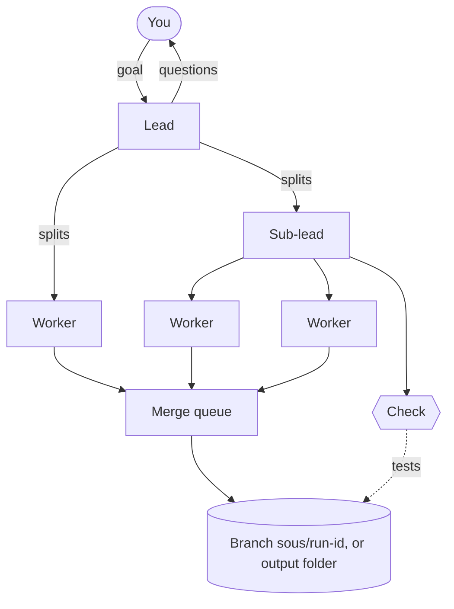

# sous

[](https://www.npmjs.com/package/@krimvp/sous)
[](package.json)
[](LICENSE)

sous runs a goal to completion on your machine with a tree of AI agents.

You give it a goal. A **lead** agent splits the goal into parts. **Workers** (Claude Code, Codex, Pi or Factory
Droid) do the parts. **Checks** test the result. Plain code, not a model, starts every process, delivers every
message, merges the work and recovers after a crash. Only merge conflicts go to an agent.

The name comes from the kitchen brigade: the sous chef splits an order across the stations, and each plate is
inspected before it leaves the kitchen.

- **Local.** One process per run. The whole state is plain files in `.sous/runs/<run-id>/`.
- **Any worker.** Each coding-agent CLI sits behind a small adapter. All four pass the same conformance suite.
- **Safe to stop.** `sous resume` continues a stopped or crashed run and does not repeat finished work.
- **Your branch stays yours.** In a git repository the result is a new branch. sous does not change your checkout.
- **Open traces.** Runs export to [ATIF](https://github.com/laude-institute/harbor) and to Langfuse over OTLP.

## How it works



A run is a tree of **nodes**. Each node has one kind:

| Kind | Done by | What it does |
|---|---|---|
| `lead` | a language model with planning tools | Splits its task into child nodes, reacts to their results, and completes. |
| `work` | a worker CLI | Does one part of the work in its own git worktree or folder. |
| `check` | a shell command | Passes when the command exits with code 0. |
| `gate` | you | Waits until you approve it with `sous approve` or reject it with `sous cancel`. |

Each node runs in **turns**. A turn is one start of a worker process, or one call to the lead's model. A message to
a node waits in its inbox until the next turn, or it interrupts the current turn. The supervisor writes every
decision to an append-only event log. Status, traces and recovery all come from that log.

## Requirements

- **Node.js 22.19 or later**, on Linux or macOS. The tests run on Linux.
- **At least one worker CLI**, installed and logged in: [Claude Code](https://claude.com/claude-code),
  [Codex](https://github.com/openai/codex), [Pi](https://github.com/earendil-works/pi) or
  [Factory Droid](https://docs.factory.ai/cli/getting-started/overview). See [docs/harnesses.md](docs/harnesses.md).
- **A model credential for the lead.** A worker CLI's login does not count. See [Lead models](#lead-models).
- **git** for code work. Without git, sous uses [folder mode](#where-the-result-goes).

## Install

```bash
npm install -g @krimvp/sous
```

To run from a clone instead, use `node src/cli.ts` in place of `sous`. Node runs the TypeScript sources directly.

## Quick start

1. Give the lead a model credential. For example, an Ollama Cloud key:

   ```bash
   export OLLAMA_API_KEY=...
   ```

2. Go to the repository the agents must work in, and commit the files they need. Workers see only your last
   commit (`HEAD`). sous warns you when the checkout has uncommitted changes. When you start it in a subdirectory,
   it uses the repository root and tells you so.

3. Make sure that a run can start:

   ```bash
   sous doctor
   ```

   `sous doctor` lists the worker CLIs on your `PATH`, the lead credentials and model, and the git state. It does not
   check that a worker CLI is logged in.

4. Start the run:

   ```bash
   sous run "Add greeting.txt containing hello, with a check that verifies it"
   ```

5. When the run is complete, examine the branch it names, for example `sous/<run-id>`. Merging that branch is your
   decision.

## Commands

| Command | What it does |
|---|---|
| `sous run "<goal>"` | Starts a run. A lead splits the goal. |
| `sous run <graph.json>` | Starts a run from a fixed graph file. |
| `sous status [run-id]` | Shows the tree of the latest run, the running turns, and what waits for you. |
| `sous runs` | Lists the runs of this workspace, newest first. |
| `sous answer <node> "<text>"` | Answers a question from a node, or gives a lead a correction. |
| `sous approve <node>` | Approves a gate, or a proposed split. |
| `sous cancel <node>` | Stops a node and its subtree, or rejects a gate. |
| `sous resume [run-id]` | Continues a run after Ctrl-C or a crash. |
| `sous ui [--port <n>]` | Serves a local web page that shows the runs, live or finished. It listens on `127.0.0.1` only, needs the token in the address it prints, and only reads the runs. |
| `sous export atif` | Writes `.sous/runs/<run-id>/trace.atif.json`. |
| `sous export otlp` | Sends the trace to Langfuse. Needs `LANGFUSE_HOST`, `LANGFUSE_PUBLIC_KEY` and `LANGFUSE_SECRET_KEY`. |
| `sous doctor` | Shows if a run could start here, and what is missing. |
| `sous --help`, `sous --version` | Shows the usage, or the installed version. `sous <command> --help` shows one command. |

Send `answer`, `approve` and `cancel` from a second terminal while the run is active. When more than one run is
active, add the run id at the end.

Useful options for `sous run`:

- `--max-depth <n>`: how deep leads can nest, from 1 to 8. The default is 3.
- `--agents <file>`: agent definitions and model limits for a goal run. See [Agents](#agents).
- `--approve-splits`: each split that a splitter proposes waits for your approval. It needs an agent named
  `splitter`. See [Splitter](#splitter).

Every command also accepts `--workspace <dir>`: the directory to work in. The default is the current directory, or
the repository root when you are inside a git repository.

## Lead models

A lead runs on one of these providers:

| Provider | Default model | Credential |
|---|---|---|
| Ollama Cloud | `ollama-cloud/deepseek-v4.1-flash` | `OLLAMA_API_KEY` |
| Anthropic | `anthropic/claude-haiku-5-5` | `ANTHROPIC_API_KEY`, or a Pi login |
| OpenAI | `openai/gpt-6-luna` | `OPENAI_API_KEY`, or a Pi login |
| ChatGPT subscription | `openai-codex/gpt-5.5` | a Pi login |

When a lead names no model, sous uses the first provider in this table that has a credential. The run prints its
choice on the `agents:` line and keeps it when you resume the run. When no provider has a credential, sous refuses
the run and tells you what to do. The Anthropic and OpenAI leads have not had a live test yet.

To use a Pi login, install Pi, start it, and type `/login`:

```bash
npm install -g --ignore-scripts @earendil-works/pi-coding-agent
```

sous reads the login from `~/.pi/agent/auth.json` and does not refresh it. When the login expires, start `pi` once
to refresh it.

> [!WARNING]
> Workers inherit your environment. If `ANTHROPIC_API_KEY` or `OPENAI_API_KEY` is set, Claude Code (and possibly
> Codex) workers bill that API key instead of your subscription. If your workers use a subscription, give the lead
> `OLLAMA_API_KEY` or a Pi login.

## Agents

An **agent** is a named way to do work. Each agent runs on one runtime: `claude`, `codex`, `pi`, `droid`, or `lead`.
An agent can also have a `model` and standing `instructions`, which sous adds to every brief the agent gets.

- The built-in agents `claude`, `codex`, `pi`, `droid` and `lead` need no definition.
- A work node that names no agent uses the run's `agent`, when the graph or agents file sets one. If not, it uses
  the first worker CLI on your `PATH`, in this order: Claude Code, Codex, Pi, Droid. Each uses its own default model.
- A node's `model` overrides its agent's model.
- A goal can ask for an agent, for example "use agent pi for every work child".
- Merge conflicts go to the **integrator**, an agent that resolves them. By default it is the first available of
  Codex, Claude Code, Pi and Droid. To choose it, define an agent named `integrator`.

Define agents in a file and give it to `sous run --agents agents.json "..."`:

```json
{
  "agents": {
    "lead": { "runs": "lead", "model": "anthropic/claude-sonnet-5-5" },
    "reviewer": { "runs": "codex", "instructions": "Review only. Do not change files." }
  },
  "models": { "claude": ["haiku"], "pi": ["ollama-cloud/glm-5.2"] }
}
```

`models` sets which models a lead can choose for each runtime. A lead can also define a new agent for a child, for
example `{ "name": "hr", "runs": "pi", "instructions": "..." }`. It can do this only on a runtime that `models`
lists, and only with one of the listed models. When the lead names no model, the agent gets the first listed model.
The lists also limit the model that a lead sets on a child. When a runtime has no list, a lead cannot define agents on
it or choose a model for it. The agents and models that you write yourself have no such limit.

## Fixed graphs

In a graph file, you write the nodes yourself. A graph can also contain leads.

```json
{
  "goal": "Add a greeting",
  "agent": "claude",
  "agents": { "reviewer": { "runs": "codex", "instructions": "Review only. Do not change files." } },
  "nodes": [
    { "id": "write",  "kind": "work",  "brief": "Create greeting.txt containing: hello" },
    { "id": "review", "kind": "work",  "agent": "reviewer", "needs": ["write"], "brief": "Review greeting.txt" },
    { "id": "verify", "kind": "check", "needs": ["write"], "command": "grep -qx hello greeting.txt" },
    { "id": "ship",   "kind": "gate",  "needs": ["verify"], "brief": "Keep greeting.txt?" }
  ]
}
```

```bash
sous run graph.json
```

`needs` lists the nodes that must complete first. The skill reference lists every field:
[.agents/skills/sous/REFERENCE.md](.agents/skills/sous/REFERENCE.md).

## Splitter

A **splitter** is an agent that plans the split for every lead. Use it when you want one planning strategy, or a
stronger model for planning than for leading. Define an agent named `splitter` on a worker runtime, with the strategy
as its instructions:

```json
{ "agents": { "splitter": { "runs": "claude", "model": "opus", "instructions": "One part per module, tests first." } } }
```

Before each lead gets its brief, the splitter reads the work merged so far and proposes the lead's children. The lead
can use the proposal, change it, or ignore it. With `sous run --approve-splits`, each proposal waits for you: use
`sous approve <lead>`, or `sous answer <lead> "<changes>"`.

To give one subtree a different splitter, set `"roles": { "splitter": "<agent>" }` on a lead in a graph file. Its
sub-leads use the same splitter.

## Where the result goes

sous selects the mode when the run starts. In both modes, work nodes run in parallel, and at most 4 workers and
checks run at the same time.

**Git mode** (the workspace is in a git repository). The repository must have at least one commit. If it has none,
the run fails.

- Each work node runs in its own git worktree.
- When a node is done, sous merges its branch into the run's branch `sous/<run-id>`, one merge at a time.
- A conflict, or a check that fails after a merge, goes to the integrator.
- Your checkout does not change. `sous status` names the result branch.

**Folder mode** (git is not installed, or the workspace is not in a git repository). Use it for research, writing and summaries:

- Each worker runs in its own folder. The folder has two links: `workspace/` (your files) and `results/` (the
  results so far). Workers are told to read these and write only at the top of their own folder.
- sous copies each worker's files into `.sous/runs/<run-id>/output/`, one node at a time.
- When two nodes write different files with the same name, sous keeps both. The second gets a name such as
  `report.<node>.md`. Nothing in the output is replaced.
- Your files are only read. `sous status` names the output folder.

A lead can complete even when a check failed. Then `sous run` and `sous status` show
"completed with failed checks: ...".

## While a run works

- **Workers can talk.** A worker can tell a sibling or its lead something the others must know, such as an interface
  it settled. It uses the `send` and `receive` tools of sous's MCP server, or the commands `sous send` and
  `sous receive`. The lead sees every message, and the event log records it.
- **Workers are kept apart from your setup.** Workers get sous's MCP server, and as few of your own MCP servers,
  skills, hooks and settings as each CLI allows. Some parts still load: for example, Codex reads your global
  `~/.codex/AGENTS.md`, and Claude Code reads the `CLAUDE.md` files above the worktree. The project's own instruction
  files apply. [docs/harnesses.md](docs/harnesses.md) gives the details for each CLI.
- **Leads can look first.** Before it splits its task, a lead can list and read the files of the workspace and the
  results so far. It cannot change them.
- **You can watch.** `sous status` shows each running turn's age and the last time its output grew. A turn with no
  output for 10 minutes is reported once as `turn.stalled`. `sous ui` shows the tree, a timeline, each lead's decisions
  and each worker's turns.
- **You can stop and continue.** Press Ctrl-C to stop a run. `sous resume` continues it. A finished turn is recorded and
  not repeated. An interrupted worker continues its session with a note to examine the workspace again. A node that is
  interrupted more than 3 times fails.

## Security

> [!CAUTION]
> Workers are not sandboxed. They run as you, with full permissions in their worktree or folder, and they have your
> shell, your files and your network.

A worker, or a program it starts, can also write the files that `sous answer`, `approve` and `cancel` write. Thus a
worker can forge an approval, an answer or a cancel. Until workers are sandboxed
([#43](https://github.com/krimvp/sous/issues/43)), a gate protects you only as much as you trust the agents you run.

## Documentation

- [docs/design.md](docs/design.md): concepts, architecture, recovery, merging and the roadmap.
- [docs/harnesses.md](docs/harnesses.md): the worker CLIs, what sous keeps out of them, and how to add one.
- [.agents/skills/sous](.agents/skills/sous/SKILL.md): a skill that teaches a coding agent to start, watch, steer and
  export runs. Claude Code finds it through `.claude/skills`.
- [CHANGELOG.md](CHANGELOG.md): the changes in each release.
- [krimvp.github.io/sous](https://krimvp.github.io/sous/): the landing page.
- [CONTRIBUTING.md](CONTRIBUTING.md): how to build, test and send changes.

## License

[MIT](LICENSE)
